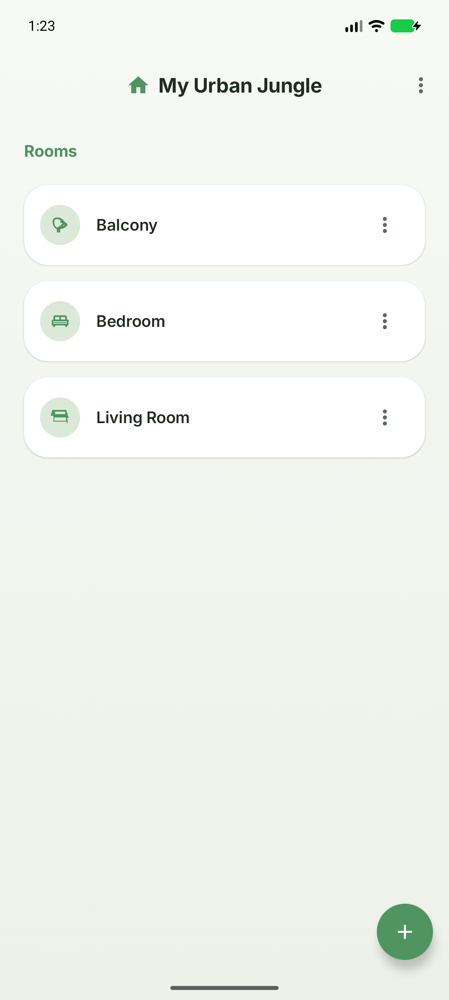
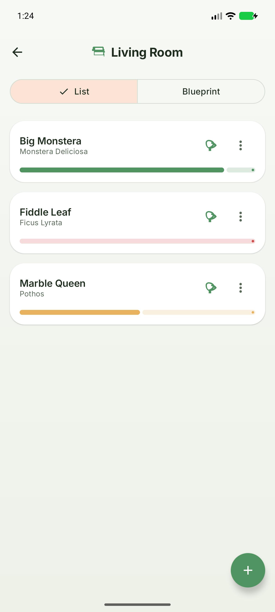
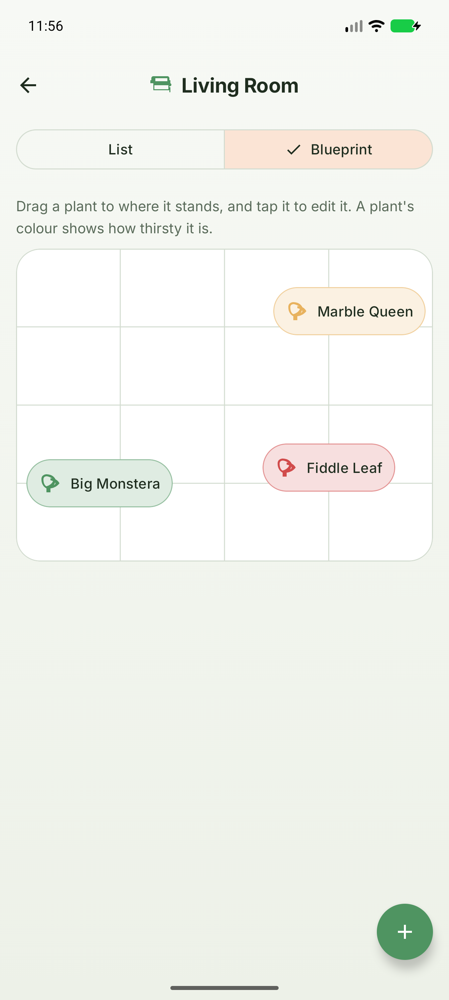
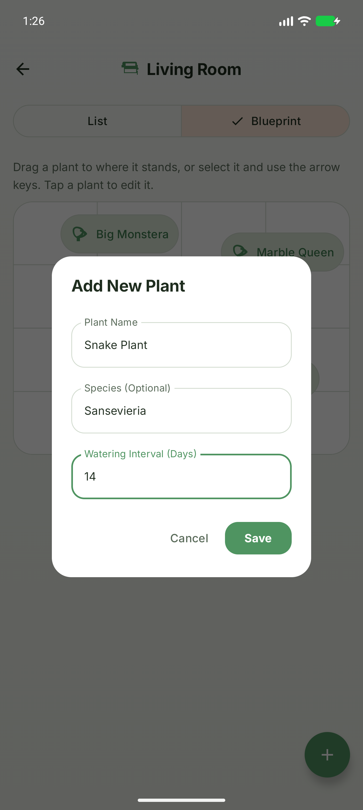
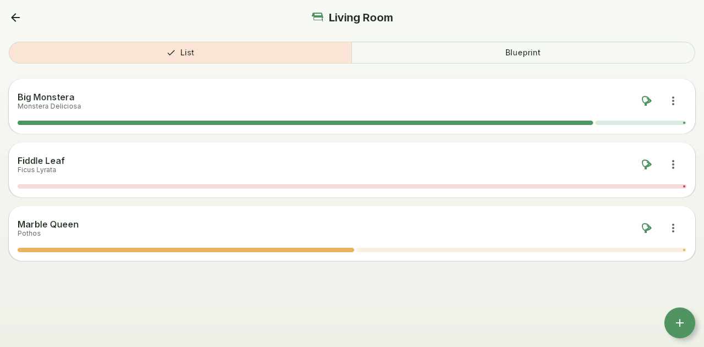
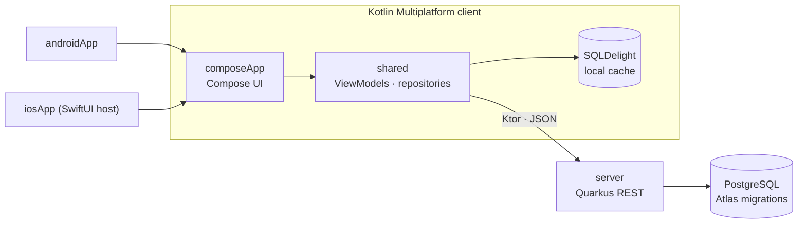

# 🌿 GreenPrint

[](https://github.com/marcowuethrich/green-print/actions/workflows/ci.yml)
[](https://kotlinlang.org)
[](https://www.jetbrains.com/compose-multiplatform/)
[](https://quarkus.io)
[](#run-it)
[](LICENSE)

**A small Kotlin Multiplatform app, and a template for building software with coding agents.**

GreenPrint keeps track of your houseplants room by room, and lays each room out as a top-down
blueprint where you drag every plant to where it really stands. One Compose codebase runs on
Android, iOS, desktop and the web, works offline, and syncs with a Quarkus server.

The app is deliberately small. The interesting part is *how* it is built: agents (Claude Code,
Codex, Gemini CLI) write most of the code inside a repository engineered for them, with a short
instruction map, project skills, a guard hook, zero-findings gates and self-hosted CI.
→ **[The agentic engineering workflow](docs/agentic/README.md)**

<p align="center">
  
  
  
  
</p>
<p align="center">
  
</p>

## Features

- **Spaces, rooms and plants.** Organise a home, an office or a flat into rooms; track each plant's
  species, pot, soil and watering interval; edit, archive and delete with confirmation.
- **Spatial blueprint.** Every room as a floor plan seen from above. Drag a plant to its spot; the
  position is saved when you let go. Arrow keys and screen-reader actions move it too.
- **Watering.** One tap records a watering; each plant's bar shows how much of its interval is
  left, from healthy through thirsty to dry.
- **Offline first.** Moves and waterings land in the local SQLDelight database first (in the
  browser too, kept in IndexedDB) and sync to the server when it is reachable; a dot shows what has
  not synced yet.
- **One UI, four platforms.** Compose Multiplatform for Android, iOS, desktop (JVM) and web (Wasm).

## Architecture



| Module | Holds |
|---|---|
| [`shared`](shared) | Domain models, ViewModels, repositories, the SQLDelight schema, Ktor and Koin wiring |
| [`composeApp`](composeApp) | The Compose UI for every platform, plus the desktop, web and iOS entry points |
| [`androidApp`](androidApp) | The Android application shell (AGP 9 keeps it apart from the KMP libraries) |
| [`iosApp`](iosApp) | The Xcode project hosting the shared UI |
| [`server`](server) | Quarkus REST API with Hibernate Panache, validation and Atlas migrations |

Decisions are recorded as [ADRs](docs/architecture/decisions.md); the
[architecture overview](docs/architecture/overview.md) has the C4 diagrams and the sync strategy.

**Stack:** Kotlin 2.4 · Compose Multiplatform 1.12 · Material 3 · Koin · Ktor · SQLDelight (sql.js worker on the web) · Voyager ·
Quarkus · Hibernate Panache · PostgreSQL · Atlas · ktlint + Compose rules · detekt.

## Agentic engineering

| Piece | Where |
|---|---|
| One instruction map for every agent: what to read for which task, the workflow, the gates | [`AGENTS.md`](AGENTS.md) (`CLAUDE.md` and `.gemini/settings.json` point to it) |
| The full workflow: instruction layers, the issue-to-merge loop, subagents, guardrails, infrastructure | [`docs/agentic/README.md`](docs/agentic/README.md) |
| Project skills, loaded on demand, and the end-to-end recipe | [`.claude/skills/`](.claude/skills/README.md) |
| A hook that refuses destructive commands, with tests | [`tools/agent_guard.py`](tools/agent_guard.py) |
| Zero-findings gate: lint, static analysis, tests, builds | `./gradlew prePRcheck` ([ADR-016](docs/architecture/decisions.md)) |
| A gate for the docs and the agent files | [`tools/docs_check.py`](tools/docs_check.py) |
| Self-hosted CI on a public repository, closed to forks | [`.github/workflows/ci.yml`](.github/workflows/ci.yml) |
| Specs before code | [`docs/features/`](docs/README.md#features) |

## Run it

Requires JDK 21+ (the build runs on JDK 25), Android Studio or IntelliJ IDEA with the Kotlin
Multiplatform plugin, Xcode for iOS, and Docker for the server's dev database.

```bash
./gradlew :server:quarkusDev                           # API on :8080, Postgres via Dev Services, demo data
./gradlew :composeApp:run                              # desktop
./gradlew :composeApp:wasmJsBrowserDevelopmentRun      # web
./gradlew :androidApp:installDebug                     # Android device or emulator
open iosApp/iosApp.xcodeproj                           # iOS, run from Xcode
```

In dev mode the server fills the database with sample spaces, rooms and plants on first use. The
apps also work without the server: changes wait in the local database and sync later. If an
Android emulator cannot reach the server, start it with `-Dquarkus.http.host=0.0.0.0`.

## Quality

```bash
./gradlew prePRcheck                                   # the whole gate, zero findings
python3 tools/docs_check.py                            # docs and agent files
python3 -m unittest discover -s tools -p 'test_*.py'   # the guard hook's tests
```

`prePRcheck` runs ktlint (with the Compose rules), detekt, the ViewModel tests, the Compose UI tests,
the server's integration tests and the Android and Wasm builds. There are no baselines: a finding
is fixed, or suppressed at its line with the reason beside it. See the [testing strategy](docs/testing.md).

## Next steps

- [Watering reminders](docs/features/notifications.md): local notifications when a plant gets thirsty.
- Undo for a watering, and the local-first outbox for creating, editing and archiving plants
  (moves and waterings already work offline).
- Moving or archiving a room's plants when the room is deleted (today the app asks to empty it first).
- Sign-in with OIDC: the server and the client's `AuthRepository` are ready for it (ADR-001, ADR-011).

## License

[MIT](LICENSE). The third-party agent skills in `.claude/skills/` are Apache-2.0
([details](.claude/skills/README.md)).
