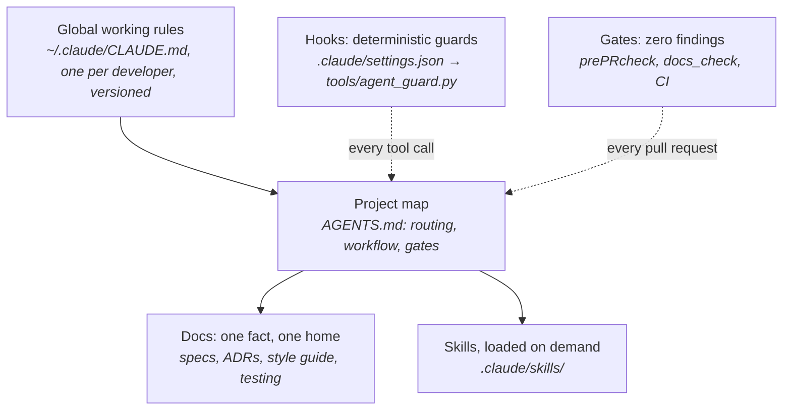
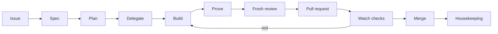

# Agentic Engineering: the GreenPrint workflow

GreenPrint is small on purpose. The app is a working example; the main product is the way it is
built. Coding agents (Claude Code, Codex, Gemini CLI) do most of the typing, so the repository is
engineered for them: its text tells them what to do, hooks stop what they must never do, and gates
check the result. This page describes that workflow as it runs every day across a production
Kotlin Multiplatform app, a machine-setup repository and this demo, and shows where each part lives
in this repository so it can be copied.

## The core idea

An agent follows the repository's text, so treat that text like code:

- **Short and routed.** `AGENTS.md` is a map, not an encyclopedia: who reads what, when. Each fact
  has one home in `docs/`, and the map points there. Long instruction files are followed less well,
  so `tools/docs_check.py` holds `AGENTS.md` under a line budget.
- **Enforced, not hoped for.** A rule an agent must never break becomes a hook (`tools/agent_guard.py`)
  or a gate (`./gradlew prePRcheck`, `tools/docs_check.py`). Prose is for judgment; code is for "never".
- **Proven, not claimed.** "Done" means the change ran the way a user would use it, with evidence.

## The layers



| Layer | Holds | Loaded |
|---|---|---|
| Global rules | how to work with *this developer* in every project: ask with the question tool, prove before claiming, keep a list of open items | every request, so a few dozen lines at most |
| `AGENTS.md` | how to work in *this repository*: what to read for which task, the workflow, the gates | every request in the project |
| `docs/` | the facts: feature specs, ADRs, the style guide, the testing strategy | only when the map routes there |
| Skills | recipes for recurring jobs: build a feature, review a diff, write tests | only the description, until a task matches |
| Hooks | the "never" rules, as code | before every tool call |
| Gates | lint, static analysis, tests, docs checks; zero findings, no baseline | before every pull request and in CI |

## The loop



1. **Issue.** Work comes from the board. One issue gets one branch, one worktree
   (`.agents/worktrees/<slug>`) and one pull request that closes it. Nobody commits to `main`.
2. **Spec.** A change a user sees starts as a spec in `docs/features/`; an architectural choice as
   an ADR. Agents write them too, and the developer reviews them first: a wrong spec costs more than
   wrong code.
3. **Plan and delegate.** The lead agent splits the work into self-contained tasks and hands them
   to subagents with a complete brief. It keeps the integration, the questions and the pull request.
4. **Build.** With the project's skills (`.claude/skills/`): placement in the right layer, the data
   layer, Compose UI, tests.
5. **Prove.** Walk *Hit every surface* in `AGENTS.md` (platforms, offline, reverse states,
   accessibility, strings, docs). Run the change for real (the app on a simulator, desktop or
   browser) and keep a screenshot. Run the gate once, clean.
6. **Review.** A fresh agent that did not write the code reviews the diff. It gets the code, not
   the author's conclusion, so it is not anchored on it.
7. **Pull request, watch, merge.** The template asks for the surfaces, the evidence and the gate.
   The agent watches the checks, fixes red builds in the branch, answers review threads, and merges
   only when every check is green and every thread is resolved. Never `--admin`.
8. **Housekeeping.** Fast-forward the main checkout, remove the worktree and branch, file whatever
   stayed open as a new issue.

## Working rules

These are the global rules, written once per developer and loaded in every project. Each one
exists because its absence cost time.

| Rule | Why |
|---|---|
| **Done means run.** Build it, start it, use what changed the way a user would, show the evidence; name what could not be run as not verified. | Green unit tests do not prove a screen works. |
| **Decide or ask, never dangle.** Questions go through the question tool, with a recommendation first. | A question buried in a long reply gets lost. |
| **Result first, plain words.** The outcome in the first sentence, details after. | The developer reads the top and decides. |
| **Do every step you can yourself.** The terminal, APIs, a real browser, a simulator; hand over only what needs a human's hands, eyes or identity, one step at a time. | Instructions for the human are the slowest path. |
| **Say only what you observed.** "Running" or "merging" needs a fresh check. | Agents otherwise report plans as facts. |
| **A turn ends with no orphaned work.** Every open item is done, has a wake-up (a pull request watch, a background task, a subagent's completion, a schedule), or is the developer's by name. A Stop hook holds the turn while one is not. | "I'll check later" is a promise no one keeps. |
| **Housekeeping after every merge.** Main checkout fast-forwarded, finished worktrees and branches removed. | Dozens of stale worktrees accumulate within a week otherwise. |
| **No AI attribution** in commits, pull requests or comments. | The developer owns the work. |

## Subagents

The lead agent delegates, and picks each subagent's model and reasoning effort by the task's
hardest step, not by its topic or size.

| Model tier | For | Examples |
|---|---|---|
| Small, fast | mechanical work the lead checks at a glance | run a command and report, fetch a log, move an issue |
| Mid | a procedure a skill or README spells out | watch a pull request through CI, run a gate and report |
| Large | judgment | write a spec or ADR, implement, debug, review |
| Design-specialised | how a page or component looks | a screen's layout and styling (the logic stays with the large tier) |

| Effort | When |
|---|---|
| medium (default) | the spec, the located cause or the recipe settles what to do, and tests or review check the result |
| high | something must be found or decided alone: a root cause, an open design, a fresh review, an unattended loop of hours |
| xhigh | a wrong result would pass tests and review: auth, migrations, sync, security; or a long unattended run |

- **Brief it whole.** A subagent sees only its brief: the task, the worktree, the files it owns, the
  rules it must keep, what to return. It cannot ask the developer, so it returns a question with
  a recommendation instead.
- **Measure, then fan out.** How many run at once depends on the machine's free memory and load,
  measured before each launch; never more than three at the highest effort (rate limits).
- **Retry one step up.** A subagent that stopped early runs again one effort level higher; one that
  misread the task gets a clearer brief, not a bigger model.

## Guardrails as code

`tools/agent_guard.py` runs before every shell command and file write (`.claude/settings.json`).
It refuses pushes to `main`, force pushes, skipped git hooks, `git reset --hard`, dropped databases,
deleted Docker volumes, lint baselines, and killing shared build daemons. It reads the command with a
real lexer, so a commit message that *mentions* `git push origin main` passes. It fails open: a bug
in the guard never blocks a session. Try it:

```bash
python3 tools/agent_guard.py --check 'git push origin main'   # deny: Pushing to `main` bypasses review
python3 -m unittest discover -s tools -p 'test_*.py'          # its tests
```

**Secrets never enter the context.** In the real setup a small wrapper around the password manager
injects a credential into the one command that needs it (an environment variable or a file the
command reads), so the agent sees the command but never the value. A hook refuses a raw
password-manager call. Unlocking needs the developer's fingerprint on the laptop.

## Zero findings, no baseline

`./gradlew prePRcheck` runs ktlint (with the Compose rules), detekt, the shared ViewModel tests, the
Compose UI tests, the server tests, and the Android and Wasm builds. A finding gets fixed; a
suppression sits at its line with the reason next to it. There are no baseline files and no raised
thresholds: a baseline is a list of problems everyone has agreed to stop seeing, and agents copy
whatever pattern they find.

The docs get a gate too. `tools/docs_check.py` fails on a broken link, a document missing from
`docs/README.md`, a skill without a valid `name` and `description`, an instruction file over its
budget, or an AI attribution line.

## The infrastructure behind it

The workflow runs on a small, reproducible setup:

- **An always-on agent server.** A headless Mac mini runs the agent GUI's server, a model proxy, the
  CI runners, a Gradle remote build cache and the iOS simulators and Android emulators. The laptop is
  a thin client over a private mesh VPN, so long agent runs survive a closed lid.
- **Everything as code.** Both machines are rebuilt from a private setup repository: idempotent
  steps, a read-only doctor that checks the result, and every change rehearsed in a throwaway VM
  first. Global rules, skills, hooks and the agents' settings are versioned and linked from there,
  so an edit is reviewed in a pull request like any other code.
- **Self-hosted CI, one isolated user per repository.** Each repository's runner runs as its own
  macOS user, so one project's job cannot read another's caches or credentials. Simulator and
  emulator jobs take a slot from a small lock service, so parallel agents and CI never fight over a
  device.
- **Real devices and a real browser.** Agents drive simulators, emulators and phones through a device
  tool, and a dedicated, logged-in browser profile per project for consoles that have no API.
- **Text is tested too.** Changes to the global rules or a skill run small evals: a real model in a
  headless session against the new text, graded by the tool calls it makes. Instruction files have a
  byte budget that CI enforces. Periodic audits review the repository and the agent setup itself.

### Self-hosted CI on a public repository

A self-hosted runner on a public repository would run code from any fork's pull request. GreenPrint
closes that (`.github/workflows/ci.yml`):

- Every job runs only for pushes to `main`, manual runs, and pull requests from branches of this
  repository: `if: github.event_name != 'pull_request' || github.event.pull_request.head.repo.full_name == github.repository`.
  A fork's pull request skips every job before any runner is chosen.
- The workflow never uses `pull_request_target`, the token is read-only, and actions are pinned by
  commit SHA.
- Repository settings: Actions require approval for every outside contributor, only GitHub's own
  and explicitly allowed actions may run, and interactions are limited to collaborators.

## Map of this repository

| Concept | File |
|---|---|
| Project map for every agent | [`AGENTS.md`](../../AGENTS.md) |
| Claude Code entry (imports the map) | [`CLAUDE.md`](../../CLAUDE.md) |
| Gemini CLI entry (reads the map) | `.gemini/settings.json` |
| Skills and their provenance | [`.claude/skills/README.md`](../../.claude/skills/README.md) |
| The end-to-end recipe | [`.claude/skills/feature-workflow/SKILL.md`](../../.claude/skills/feature-workflow/SKILL.md) |
| Guard hook and its tests | [`tools/agent_guard.py`](../../tools/agent_guard.py), [`tools/test_agent_guard.py`](../../tools/test_agent_guard.py) |
| Docs gate | [`tools/docs_check.py`](../../tools/docs_check.py) |
| Pull request template | [`.github/pull_request_template.md`](../../.github/pull_request_template.md) |
| CI | [`.github/workflows/ci.yml`](../../.github/workflows/ci.yml) |
| Specs and decisions | [`docs/features/`](../features/inventory.md), [`docs/architecture/decisions.md`](../architecture/decisions.md) |

## Use it in your project

1. Copy `AGENTS.md`, `CLAUDE.md`, `.gemini/settings.json`, `.claude/`, `tools/` and `.github/`.
2. Rewrite `AGENTS.md`'s routing table for your docs, and its gates for your build.
3. Replace the Kotlin skills with ones for your stack; keep the set small.
4. Adjust `tools/agent_guard.py`'s rules to your "never" list, and keep its tests green.
5. Write one global rules file for yourself, keep it short, and version it.
