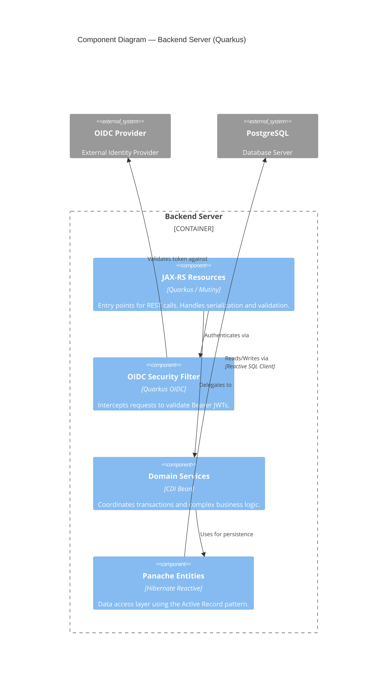
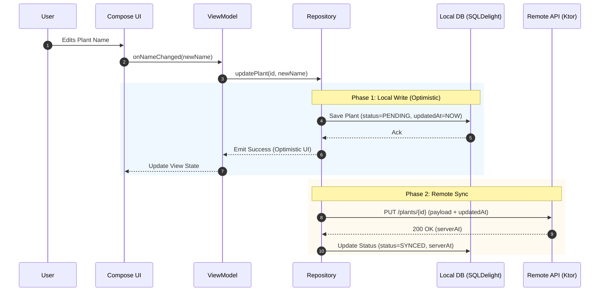
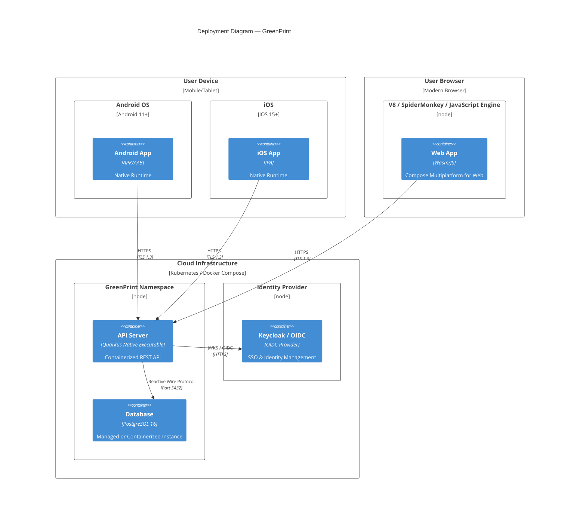

# Architecture Overview

GreenPrint is a **Kotlin Multiplatform** spatial houseplant inventory app. Shared business logic and UI run across Android, iOS, Desktop (JVM), and Web (Wasm), backed by a Quarkus REST server.

---

## Level 2 — Container

```mermaid
C4Container
  title Container Diagram — GreenPrint

  Person(user, "Plant Owner", "Uses any of the client apps to manage plants.")

  System_Ext(oidcProvider, "OIDC Provider", "Identity provider for OAuth 2.0 / OIDC (e.g. Keycloak). Issues and signs JWT access tokens.")
  System_Ext(llmApi, "LLM Vision API (Roadmap)", "AI plant identification and care-profile generation.")

  System_Boundary(gp, "GreenPrint") {

    Container(androidApp, "Android App", "Compose Multiplatform / Android", "Primary mobile interface for spatial plant management. Handles Local Notifications via AlarmManager.")
    Container(iosApp, "iOS App", "Compose Multiplatform / iOS", "Native iOS client sharing the Compose UI layer. Handles Local Notifications via UNUserNotificationCenter.")
    Container(desktopApp, "Desktop App", "Compose Multiplatform / JVM", "Desktop client for power users.")
    Container(webApp, "Web App", "Compose Multiplatform / Wasm", "Browser-based client — no install required.")

    Container(shared, "Shared Module", "Kotlin Multiplatform · Ktor · Koin · SQLDelight", "Domain DTOs, KMP ViewModels, and Offline-First Repositories. Uses SQLDelight for a local Write-Through Cache across all platforms.")

    Container(server, "Backend Server", "Quarkus / Kotlin · Hibernate Panache · quarkus-oidc", "REST API. Owns its own Panache entity layer (independent of shared DTOs). Validates Bearer tokens issued by the OIDC provider.")
    ContainerDb(db, "Server Database", "PostgreSQL + Atlas Migrations", "Persists plant profiles, user data, and watering schedules. Schema lifecycle managed by Atlas.")
  }

  Rel(user, androidApp, "Uses", "Touch UI")
  Rel(user, iosApp, "Uses", "Touch UI")
  Rel(user, desktopApp, "Uses", "Desktop UI")
  Rel(user, webApp, "Uses", "Browser")

  Rel(androidApp, shared, "Uses")
  Rel(iosApp, shared, "Uses")
  Rel(desktopApp, shared, "Uses")
  Rel(webApp, shared, "Uses")

  Rel(shared, oidcProvider, "Authenticates user via", "OIDC / OAuth 2.0")
  Rel(shared, server, "Calls REST API with", "HTTPS · Bearer JWT")
  Rel(server, oidcProvider, "Validates tokens against", "JWKS / HTTPS")
  Rel(server, db, "Reads & writes", "JDBC")
  Rel(server, llmApi, "Requests plant profiles from", "HTTPS (Future Implementation)")

---

## Level 3 — Component (Shared Module)

```mermaid
C4Component
  title Component Diagram — Shared Module (KMP)

  Container_Boundary(ui_layer, "UI Layer (Compose Multiplatform)") {
    Component(screens, "Feature Screens", "Compose", "State-aware UI components.")
  }

  Container_Boundary(shared_logic, "Shared Module") {
    Component(vm, "KMP ViewModels", "AndroidX Lifecycle", "Manages UI state and handles Intent/Action events.")
    Component(repo, "Offline-First Repository", "Kotlin", "Orchestrates data between Local Store and API Client. Implements the 'Write-Through Cache' pattern.")
    Component(db_store, "Local Store", "SQLDelight", "Persistent local cache for offline-first capabilities.")
    Component(api_client, "Remote API Client", "Ktor", "Encapsulates REST communication and authentication headers.")
  }

  Rel(screens, vm, "Observes State / Dispatches Events")
  Rel(vm, repo, "Calls domain actions")
  Rel(repo, db_store, "Reads/Writes (Single Source of Truth)")
  Rel(repo, api_client, "Synchronizes with (Background/Foreground)")
```

## Level 3 — Component (Backend Server)



---

## Dynamic Diagram — Synchronization Flow

This diagram illustrates the "Write-Through Cache" and "Last Write Wins" strategy for a typical plant update.



---

## Level 4 — Deployment


