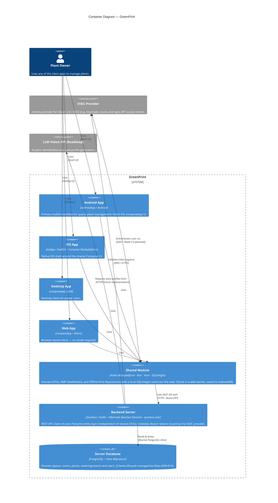
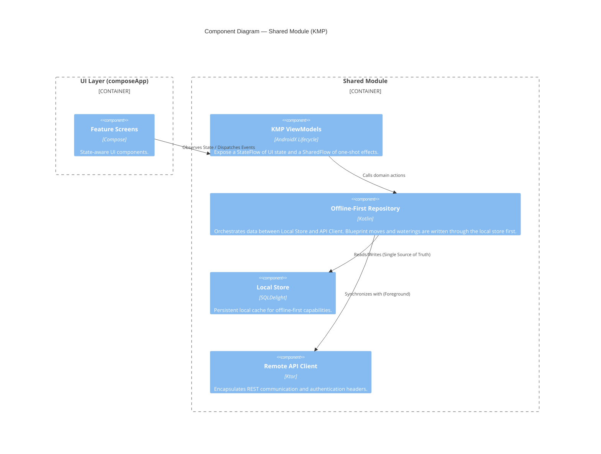
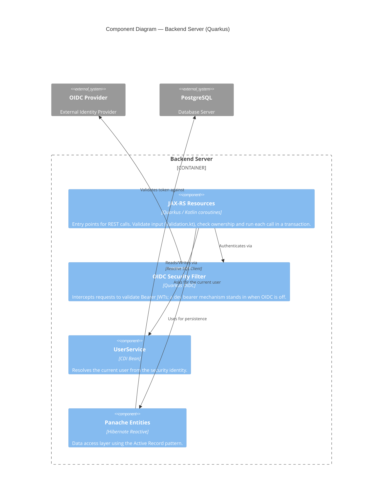
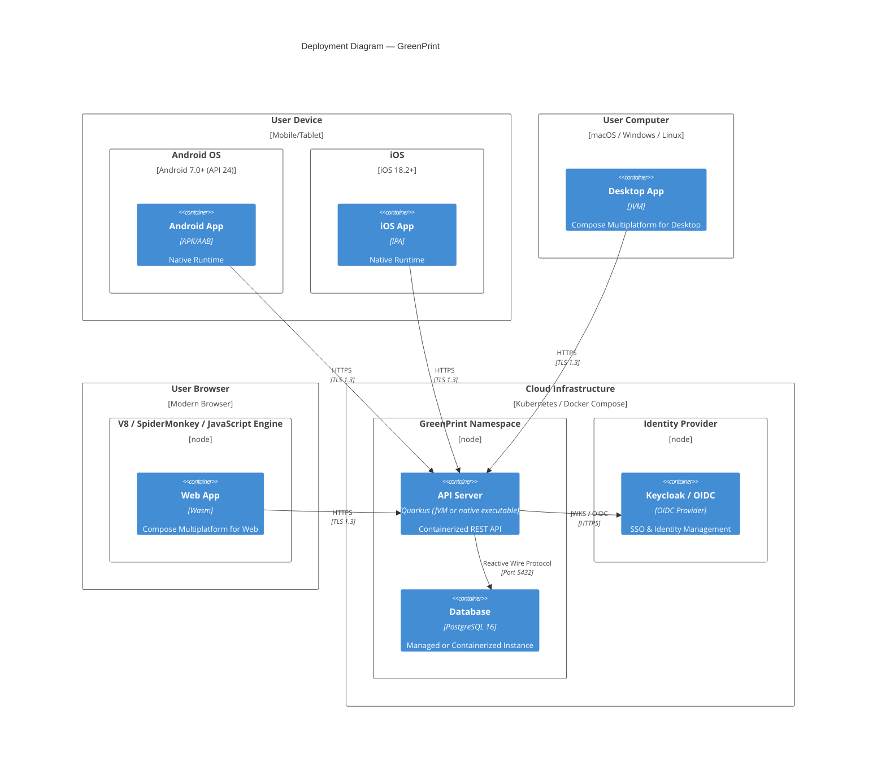

# Architecture Overview

GreenPrint is a **Kotlin Multiplatform** spatial houseplant inventory app. Shared business logic and UI run across Android, iOS, Desktop (JVM), and Web (Wasm), backed by a Quarkus REST server.

---

## Modules

| Module | Gradle plugin | What it holds |
| :--- | :--- | :--- |
| `androidApp` | `com.android.application` | The installable Android app: `MainActivity`, the Koin `Application`, the manifest and the launcher resources (ADR-015). |
| `composeApp` | `org.jetbrains.kotlin.multiplatform` + `com.android.kotlin.multiplatform.library` | The Compose Multiplatform UI for every platform, plus the Desktop (`Main.kt`), Web (`webMain`, with the cache's web worker and `webpack.config.d`) and iOS (`MainViewController`) entry points. |
| `shared` | `org.jetbrains.kotlin.multiplatform` + `com.android.kotlin.multiplatform.library` | DTOs, KMP ViewModels, repositories, the Ktor client and the SQLDelight cache. Also used by `server` for the DTOs and the blueprint coordinate limits both sides apply. |
| `server` | `io.quarkus` | The Quarkus REST API with its own Panache entities. |
| `iosApp` | — (Xcode) | The SwiftUI shell that hosts the `composeApp` framework. |

The quality gate (`./gradlew prePRcheck`: ktlint, detekt, tests and the app builds) is described in ADR-016 and [testing.md](../testing.md).

---

## Level 2 — Container



**Status notes**
- **Login**: the clients do not run an OIDC flow yet; a no-op `AuthRepository` sends a mock token (ADR-011). In the dev profile the server turns OIDC off and takes any bearer token as the user (`DevBearerAuthMechanism`); tests use `@TestSecurity`.
- **Notifications**: local watering reminders (AlarmManager, UNUserNotificationCenter) are specified in [notifications.md](../features/notifications.md) and not built yet.
- **Web cache**: the Wasm app's cache is SQLite (sql.js) in a web worker (`composeApp/src/webMain/resources/greenprint-db.worker.js`) behind SQLDelight's `WebWorkerDriver`, saved to IndexedDB after each committed write (ADR-017). The schema is generated asynchronously; the web entry point opens the cache before Koin starts. Wasm is the only web target.

---

## Level 3 — Component (Shared Module)



## Level 3 — Component (Backend Server)



---

## Dynamic Diagram — Synchronization Flow

This diagram shows the "Write-Through Cache" and "Last Write Wins" strategy as built for moving a plant on the Spatial Blueprint ([spatial_blueprint.md](../features/spatial_blueprint.md)). Quick Water follows the same two phases: the watering is logged in `WateringEventEntity` and the plant's `lastWateredDate` moves locally, then `POST /plants/{id}/waterings` confirms it (inventory.md §5, §6.2). The other plant writes still call the API first and cache its answer.

```mermaid
sequenceDiagram
    autonumber
    participant U as User
    participant UI as Compose UI
    participant VM as PlantViewModel
    participant R as PlantRepository
    participant L as Local DB (SQLDelight)
    participant A as Remote API (Ktor)

    U->>UI: Drops a plant marker
    UI->>VM: movePlant(id, x, y)
    VM->>R: updatePlantPosition(id, x, y)

    rect rgb(240, 248, 255)
    Note over R,L: Phase 1: Local Write
    R->>L: Save x, y (status=S_PENDING, updatedAt=now)
    L-->>VM: Room's plants re-emitted with the new position
    VM-->>UI: Update View State
    end

    rect rgb(255, 250, 240)
    Note over R,A: Phase 2: Remote Sync
    R->>A: PUT /plants/{id}/position {x, y}
    alt 200 OK
        A-->>R: Updated plant
        R->>L: status=S_SYNCED if updatedAt is unchanged
    else Offline or error
        R->>L: status=S_ERROR if updatedAt is unchanged
        VM-->>UI: Snackbar "saved on this device"
    end
    end

    Note over R,A: The next refresh of the room first resends every unsent watering and every row that is not S_SYNCED,<br/>then fetches; a row with an unconfirmed change is never overwritten by the server's copy.
```

---

## Level 4 — Deployment

The target deployment; the repository ships no deployment manifests yet.


