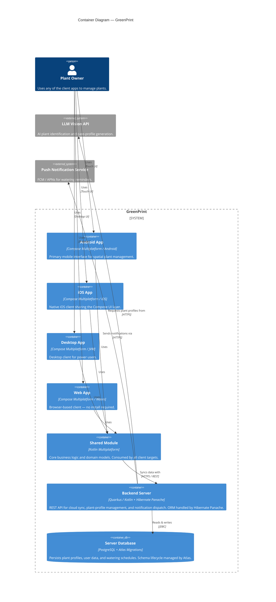

# Architecture Overview

GreenPrint is a **Kotlin Multiplatform** spatial houseplant inventory app. Shared business logic and UI run across Android, iOS, Desktop (JVM), and Web (Wasm), backed by a Quarkus REST server.

---

## Level 2 — Container

